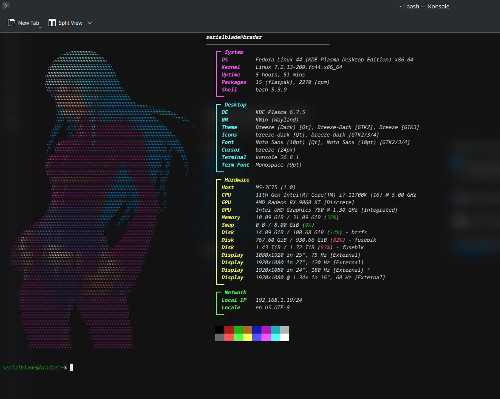

# Fastfetch : bradar toolpack 🔨

V stepped into the crowd, creating this wonderful repository to make the rice of fastfetch easier and simplier. Here you will find basic scripts to turn .png image to ascii art.

## Screenshots
Input file (I used removebg site to turn it to .png) :


Ta dam (that's crazy)


## Authors

- [@serialblade](https://github.com/serialblade)


## Installation using Fedora DNF (no Ubuntu and GNOME sorry twitch)
### Installation of dependencies

Install  fastfetch  :
 ```bash
sudo dnf install fastfetch
 ```
Install chafa :
```bash
sudo dnf install chafa
```
In case you want to use the python scripts :
```bash
  pip install --user pillow
  ```
## Features

- Sexy fastfetch
- Impressive fastfetch
- larp
## How to use?
### The fastfetch pool (Serialblade style) :

After installing fastfetch, why nothing is printed on your terminal ???? It's because you didn't call fastfetch inside your ".bashrc" file, which is loaded everytime you launch a terminal. Just write fastfetch on a newline inside of it. Save and exit : control + o, enter, control + x
```bash
nano ~/.bashrc
```

Don't forget to reload your ".bashrc" file, using the following command : 
```bash
source ~/.bashrc
```

Generate your first "config.jsonc", then you should select output to full.
```bash
fastfetch --gen-config
```

Your config is located inside the "~/.config" directory. Just run : 
```bash
cd ~/.config/fastfetch
ls -a
```

There are many ways to customize your fastfetch. I show you two ways of straight cookin in the following section.

### Logo customization (Serialblade style)
Inside your "config.jsonc", there is a logo section. It dictates how fastfetch should display your logo (it can be a .png, a .txt containing an ascii art). You can replace this section by the following ones :

#### .txt method, (ascii art)
```bash
  "logo": {
    "type": "file",
    "source": "~/.config/fastfetch/bodybuilder.txt",
    "color": {
      "1": "red"
    },
    "padding": {
      "top": 1,
      "right": 4
    }
  },
```
Here an exemple with a .txt named "bodybuilder.txt". You can customize the colors, padding, etc.

#### .png method, (images)
```bash
I'll add the code soon.
```

### The chafa pool (DRAX style) :
chafa is a wonderful tool to add colors for your logo. It is a good balance between ascii art and colorful .png art. You can run for example this following command to turn a .png image to a chafa style ascii .txt :

```bash
chafa --size 50x40 --symbols braille --fg-only --dither diffusion --work 9 --format symbols ~/Downloads/INPUTFILE.png > ~/.config/fastfetch/logos/OUTPUTFILE.txt
```

There are many rules and ways to use chafa, discover them yourself !

#### .txt method, using the previous command
```bash
  "logo": {
      "type": "file-raw",
      "source": "~/.config/fastfetch/logos/OUTPUTFILE.txt",
      "padding": {
          "top": 0,
          "right": 0
    }
  },
```

#### .png method, using the chafa feature of fastfetch
```bash
  "logo": {
      "type": "chafa",
      "source": "~/.config/fastfetch/logos/YOURFILE.png",
      "padding": {
          "top": 0,
          "right": 0
    }
  },
```


## Useful Resources

* to find ascii arts :
https://emojicombos.com/bodybuilder-ascii-art
* to get some propals : https://www.reddit.com/r/unixporn/
* to make your fastfetch as sexy as possible, you can also ask some help to bradar gemini or claude.
